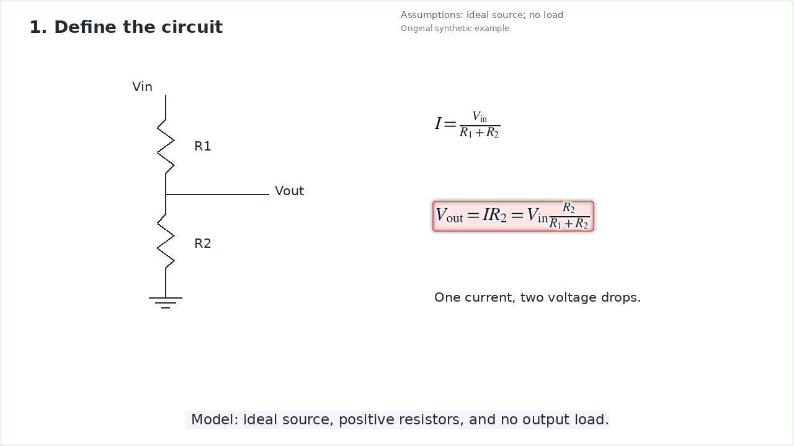

# Circuit Video Skills · 电路教学视频制作 Skill

把电路知识、模型假设、推导、画面、讲述和验证串成一条可追溯的生产链，而不是把讲义逐页变成幻灯片。

此仓库是通用 Skill 0.15.0 与后续生产改进的公开、去素材化版本。核心能力包括：知识图与局部推理白板、持久世界画布、原生像素密度公式、同源几何教鞭、语义颜色、真实字重、内部字幕安全区，以及前景注意标记与浅色底衬分层。



## 仓库内容

- `skills/circuit-teaching-video/SKILL.md`：供 AI 助手加载的入口与工作流。
- `skills/circuit-teaching-video/rendering/`：从实际生产代码提取并通用化的画布、数学、教鞭、布局与字体实现。
- `skills/circuit-teaching-video/scripts/pipeline.py`：单一 lesson JSON → 冻结场景 → 图片/视频 → 实际逐帧记录与技术检查。
- `skills/circuit-teaching-video/scripts/voice_adapter.py`：可选 TTS 适配器，显式调用才向服务发送讲述文本。
- `skills/circuit-teaching-video/rendering/source_catalog_assets.py`：可选、源文件哈希绑定的 PDF 局部裁切。
- `skills/circuit-teaching-video/references/`：内容研究、模型、字幕、生产与质量检查约定。
- `skills/circuit-teaching-video/examples/resistor-divider/lesson.json`：原创小型电阻分压演示，不是课程素材。

不包含任何课程讲义、第三方教学图、完整讲述音频、成片、账户信息或字体包。

## 快速运行

要求 Python 3.11+。视频编码还需自行安装 FFmpeg / ffprobe。先使用虚拟环境，再安装依赖：

```sh
python -m venv .venv
# Linux/macOS: source .venv/bin/activate
# Windows PowerShell: .venv\Scripts\Activate.ps1
python -m pip install -r requirements.txt
python -B -m unittest discover -s skills/circuit-teaching-video/tests -v
python skills/circuit-teaching-video/scripts/pipeline.py compile skills/circuit-teaching-video/examples/resistor-divider/lesson.json --output output/scene.json
python skills/circuit-teaching-video/scripts/pipeline.py render output/scene.json --output output/stills --width 1280 --times 2.4,6.0,7.8
python skills/circuit-teaching-video/scripts/pipeline.py render output/scene.json --output output/video --width 640 --fps 15 --video
```

最后一条生成 8 秒无声演示，120 帧。加 `--audio path/to/audio.wav` 可混入长度匹配的自有录音；这不会自动证明字幕对齐。`--width 3840 --fps 30` 可生成原生 4K，但应先审阅小样与原生清晰度样帧。

作为 Skill 使用时，将整个 `skills/circuit-teaching-video` 文件夹放入支持 `SKILL.md` 的助手的技能目录，或明确让助手读取该文件。不自动安装、不改动全局配置。

## 中文字体与可选适配器

默认使用 Matplotlib 自带 DejaVu Sans，适合英文演示；缺字会报错，不会悄悄替换。中文生产请从 [Noto CJK 官方仓库](https://github.com/notofonts/noto-cjk/tree/main/Sans) 自行取得同家族的 Regular 与 Medium 字体，设置：

```sh
export CIRCUIT_FONT_REGULAR=/path/to/NotoSansCJKsc-Regular.otf
export CIRCUIT_FONT_HEADING=/path/to/NotoSansCJKsc-Medium.otf
```

Windows PowerShell 使用 `$env:CIRCUIT_FONT_REGULAR="..."` 与 `$env:CIRCUIT_FONT_HEADING="..."`。字体变更后必须重新编译场景。没有复制字体文件；上游许可证不受本仓库许可证替代。

PDF 与 TTS 按需安装 `requirements-optional.txt`，先阅读 [适配器边界](skills/circuit-teaching-video/references/adapters.md) 和 [依赖许可说明](THIRD_PARTY_NOTICES.md)。基础示例不需要网络、TTS 或 PDF 依赖。

## 已实现与边界

- 已执行：原创示例编译、静帧、原生 4K 样帧、8 秒完整编码、精确解码帧数、逐帧几何、负向回归与底衬像素保护测试。
- 主渲染器支持文字、公式、线、框、经验证的白底 PDF 裁切、世界镜头、累积对象及屏幕字幕；不是自动电路拓扑求解器或仿真器。
- 可选语音适配器保存实际句边界与缓存证据。公开版没有执行在线合成，也没有自动把任意语音事件转成最优教学动作。实际声音、逐词对齐及完整视听审阅必须分别确认。
- 源内容/模型正确性、教学效果、所有输入字体/公式的支持，均不能由技术 PASS 推断。
- 新增来源时自行确认使用与再分发权。公开此 Skill 不会授予任何第三方课程、图片、音频或字体的权利。

更多信息：[生产工作流](skills/circuit-teaching-video/references/production-workflow.md) · [公共版范围与来源](PROVENANCE.md) · [安全说明](SECURITY.md)。

## 许可证

本仓库代码、文档与原创示例采用 [MIT 许可证](LICENSE)，Copyright (c) 2026 cottman99。第三方素材、字体、依赖及服务仍受各自条款约束；MIT 不替代这些权利与义务。详见 [依赖许可说明](THIRD_PARTY_NOTICES.md)。
